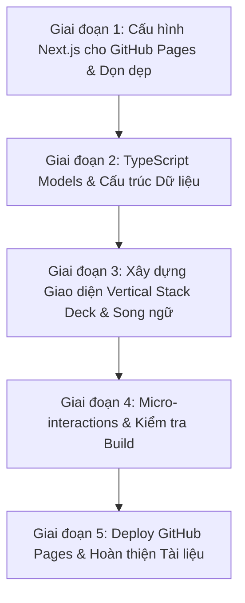

# 🚀 Lộ Trình Xây Dựng Dev Portfolio Chuẩn Xịn (GitHub Pages & Modern Minimalist)

Tài liệu này đóng vai trò vừa là **kế hoạch dự án (Checklist)**, vừa là **sổ tay học tập (Knowledge Base)** để hiểu sâu lý do tại sao lại chọn kiến trúc và cách viết code này.

---

## 📌 Định Hướng Thiết Kế & Công Nghệ

| Tiêu chí | Quyết định | Giải thích chi tiết |
| :--- | :--- | :--- |
| **Nền tảng Deploy** | **GitHub Pages** | Deploy tự động thông qua GitHub Actions (`.github/workflows/deploy.yml`), xuất static HTML (`output: 'export'`), chạy 24/7 hoàn toàn miễn phí. |
| **Phong cách UI** | **Modern Minimalist & Vertical Deck** | Thiết kế theo trường phái Brutalist / Editorial tối giản kết hợp icon Lucide tinh gọn, đường kẻ viền thanh lịch, mã số thứ tự `01/`, hỗ trợ giao diện Sáng / Tối (Dark/Light mode) và song ngữ Anh / Việt (EN / VI). |
| **Hình ảnh cá nhân** | **Có Avatar** | Khu vực Avatar chuyên nghiệp, đóng khung viền kép sắc sảo ở phần Hero. |
| **Ngôn ngữ** | **TypeScript (Strict)** | Định nghĩa Type rõ ràng, không dùng `any`, rèn luyện tư duy lập trình vững chắc. |
| **Framework** | **Next.js 16 + Tailwind CSS v4 + Lucide React** | Tốc độ load tĩnh tức thì, tối ưu cấu trúc component với VerticalStackDeck và Command Palette (Cmd+K). |

---

## 🗺️ 5 Giai Đoạn Thực Hiện

---

### 🟢 Giai đoạn 1: Cấu hình Next.js cho GitHub Pages & Dọn dẹp Dự án
> **Mục tiêu**: Chuẩn bị dự án Next.js sẵn sàng xuất static HTML cho GitHub Pages và dọn dẹp các thư viện thừa.

- [x] **1.1. Cấu hình `next.config.ts`**:
  - Bật `output: 'export'` để sinh thư mục `out/`.
  - Cấu hình `images: { unoptimized: true }` cho GitHub Pages và `basePath` linh hoạt.
- [x] **1.2. Tạo GitHub Actions workflow (`.github/workflows/deploy.yml`)**:
  - Tự động build và deploy lên GitHub Pages mỗi khi push code lên nhánh `main`.
- [x] **1.3. Cài đặt các package cốt lõi**:
  - `next`, `react`, `react-dom`, `lucide-react`, `tailwindcss v4`, `@tailwindcss/postcss`. Loại bỏ các thư viện không cần thiết (`lenis`, `motion`, `next-themes`).
- [x] **1.4. Góc học tập**:
  - Cơ chế Static Site Generation (SSG) so với SSR và cách host static assets an toàn trên GitHub Pages.

---

### 🟢 Giai đoạn 2: Thiết kế Type Models & Cấu trúc Dữ liệu
> **Mục tiêu**: Xây dựng cấu trúc dữ liệu chặt chẽ bằng TypeScript trước khi làm giao diện.

- [x] **2.1. Tạo `types/portfolio.ts`**:
  - Định nghĩa Type: `Profile`, `Project`, `Skill`, `Experience`, `SocialLink`.
- [x] **2.2. Tạo `data/portfolio-data.ts` & `lib/i18n.ts`**:
  - Đồng bộ nguồn dữ liệu chuẩn (Single Source of Truth) kết hợp từ điển song ngữ EN/VI.
- [x] **2.3. Chuẩn bị ảnh Avatar**:
  - Đặt ảnh avatar vào thư mục `public/images/avatar.png`.
- [x] **2.4. Góc học tập**:
  - Tìm hiểu `type` vs `interface` và TypeScript Discriminated Unions.

---

### 🟢 Giai đoạn 3: Xây dựng Giao diện Vertical Stack Deck & Song ngữ (EN / VI)
> **Mục tiêu**: Lắp ráp giao diện phong cách Vertical Stack Deck với tương tác phím tắt Command Palette.

- [x] **3.1. Top Header & Navigation**:
  - Nút chuyển chế độ Sáng / Tối, chuyển đổi ngôn ngữ EN / VI, đồng hồ trực tiếp Saigon Live Clock, và Command Palette trigger (`⌘K`).
- [x] **3.2. Hero Section**:
  - Ảnh chân dung bo góc viền kép, tagline chức danh, status pill `AVAILABLE FOR DEVELOPER ROLES`, nút liên kết nhanh.
- [x] **3.3. Work History / Experience**:
  - Trình bày kinh nghiệm thực tập tại BW Industrial Development JSC với metrics định lượng, kỹ thuật Gemini OCR fallback, Redis cache, và bảo mật OAuth2 SSO.
- [x] **3.4. Work Experience / Projects**:
  - Bộ trình chiếu 3 dự án lớn (FlexiConnect Web, Food Delivery & Restaurant App, Dev Portfolio Engine) với slider chuyển tab và ProjectImageStack đa ảnh chụp thực tế.
- [x] **3.5. Capabilities & Skills Matrix**:
  - Lưới kỹ năng phân loại trực quan (Languages, Frameworks, Databases, Tools/DevOps, AI-assisted) với tooltip hiển thị ngữ cảnh ứng dụng thực tế.
- [x] **3.6. Education, Languages & Contact**:
  - Bằng Cử nhân Khoa học Máy tính HCMCOU, chứng chỉ ngôn ngữ, nút bấm sao chép email trực tiếp và liên kết mạng xã hội verified.

---

### 🟢 Giai đoạn 4: Tinh chỉnh Hiệu ứng & Kiểm tra Static Build
> **Mục tiêu**: Đảm bảo web responsive mượt mà trên desktop/mobile và lệnh build static thành công 100%.

- [x] **4.1. Hiệu ứng hover, animation Tailwind v4 và tương tác Command Palette**.
- [x] **4.2. Kiểm tra `npm run build`** đảm bảo sinh ra thư mục `out/` không một lỗi lầm và kiểm tra TypeScript `tsc --noEmit`.

---

### 🟢 Giai đoạn 5: Kích hoạt GitHub Pages & Hoàn thiện Tài liệu
> **Mục tiêu**: Web chính thức online trên GitHub Pages, link sẵn sàng gắn vào CV.

- [x] **5.1. Push code lên GitHub**.
- [x] **5.2. Cấu hình GitHub repository Settings > Pages**.
- [x] **5.3. Viết README.md và ROADMAP.md chuẩn hóa theo thực tế**.

---

## 📝 Nhật Ký Tiến Độ (Progress Log)
* **Khởi tạo và hoàn thiện dự án Next.js 16 + Tailwind CSS v4 + TypeScript + Lucide React**.
* **Định hình phong cách**: Modern Minimalist Typography & Deck Layout, hỗ trợ đa ngôn ngữ EN/VI, Dark/Light mode, Command Palette (Cmd+K), Deploy trực tiếp GitHub Pages.
